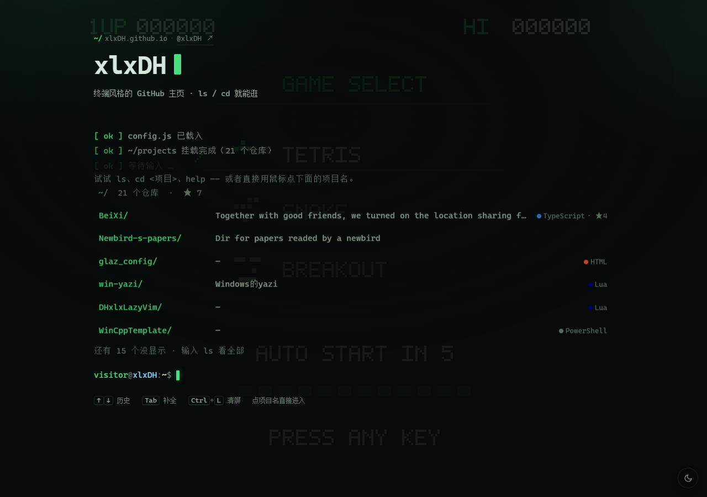
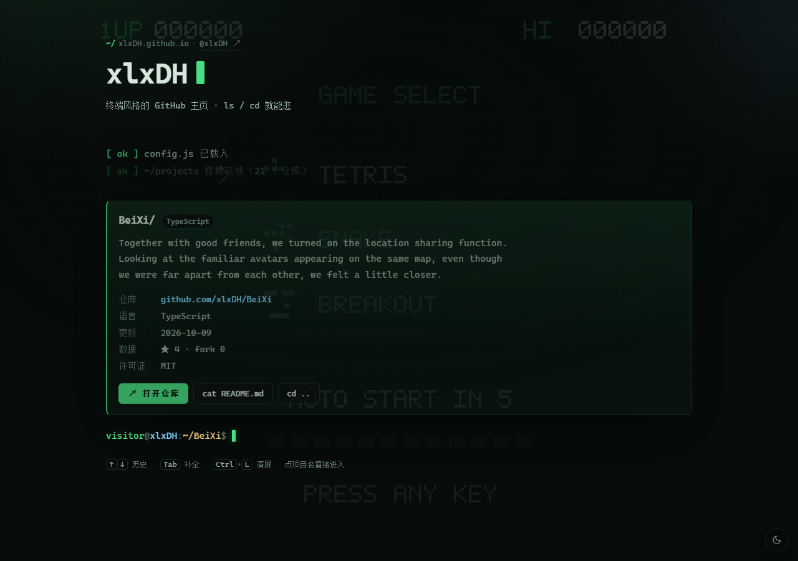
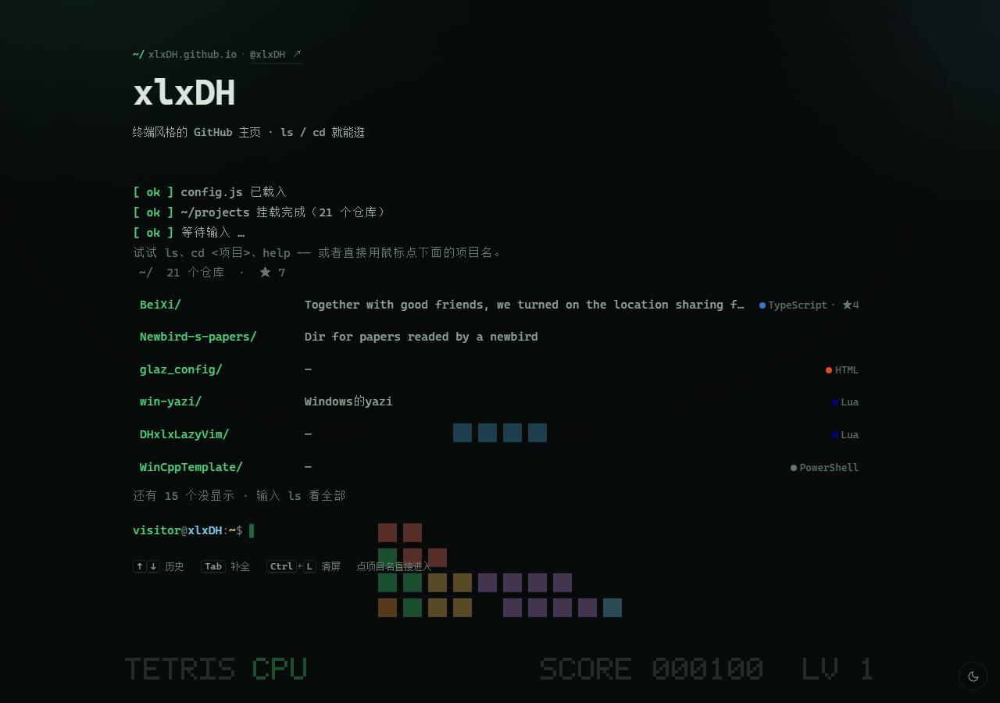
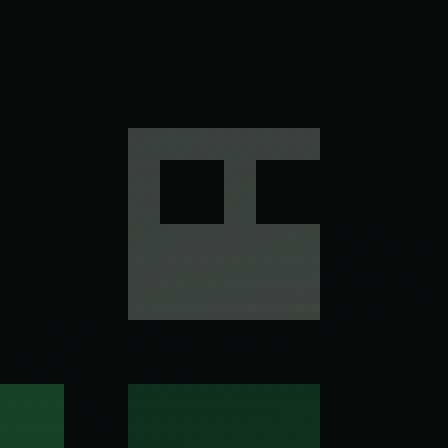

# Terminal Homepage

终端风格的 GitHub 个人主页：`ls` 看项目，`cd` 进仓库，键盘和鼠标都能用。
闲置 5 秒，背景还会亮起一台 FC 游戏机，自己挑游戏、自己打。
纯静态、零依赖、不需要构建，直接托管在 GitHub Pages 上。



`cd` 进项目后是一个可点的项目卡片，仓库会在新标签页打开：



背景游戏机：选单会在 5 秒后自己按下开始，随机挑一个游戏交给 AI：



> 截图就是 xlxDH 的真实仓库数据。

---

## 为什么选这套方案

做「终端式主页」常见有四条路：

| 方案 | 手感 | 体积 / 依赖 | 维护成本 | 适合谁 |
| --- | --- | --- | --- | --- |
| **手写静态终端**（本项目） | 够像：提示符、光标、补全、历史都有 | 106 KB（gzip 后 30 KB），0 依赖 | 改一个 `config.js` | 想要干净、快、每一行都能自己改 |
| xterm.js + local-echo | 真终端：ANSI、滚屏、光标移动 | 300 KB+，要打包 | 依赖长期升级 | 想做成 WebSSH 那种重度终端 |
| 现成主题（Hugo / Jekyll 的 terminal 主题） | 看主题质量 | 要装生成器工具链 | 模板+主题两层配置 | 想顺便把博客一起搭了 |
| React + 终端组件库 | 组件化 | 框架 + 依赖 | 中等 | 本来就在写 React |

选第一种的原因很实际：GitHub Pages 直接托管静态文件，首屏不用等框架，没有第三方供应链风险，
而且整个交互逻辑只有一个文件（`assets/js/terminal.js`），想加命令随时加。

> **一个前提**：GitHub 的 Profile README 会过滤 `<script>`，所以「能交互」只能放在 **GitHub Pages** 上，
> 在 README 里放一个链接/徽章指过去即可。本项目就是 Pages 站点本身。

## 快速开始（3 步）

1. 新建仓库 `<你的用户名>.github.io`（也可以放任意仓库，路径都是相对的，子目录同样能跑）。
2. 把本目录推上去。
3. 仓库 **Settings → Pages → Source** 选 **GitHub Actions**，等第一次 Action 跑完，
   访问 `https://<你的用户名>.github.io`。

已经被 `xlxDH` 同步过一次（21 个仓库）。以后新增仓库可以手动刷新，或等 Action 每周自动跑：

```bash
npm run sync -- xlxDH   # 重新生成 assets/js/data/projects.js
```

（不需要 `npm install`，全项目没有任何依赖。）

## 本地预览

```bash
npm run dev            # http://127.0.0.1:5173
npm run dev -- 8080    # 换端口
```

本地打开时如果名字显示成 `you`，是因为域名不是 `<user>.github.io`、推断不出用户名，
在 `assets/js/config.js` 里填上 `user` 即可。

## 能做什么

| 命令 | 作用 |
| --- | --- |
| `ls [-l] [-a]` | 列出仓库；`-l` 带更新时间，`-a` 含归档仓库 |
| `cd <项目>` | 进入项目（默认同时在新标签页打开仓库），`cd ..` 返回 |
| `cat <文件>` | 在项目里看 `README.md` / `info.json` / `LICENSE` |
| `open <项目\|链接>` | 在浏览器打开仓库、演示地址或任意 URL |
| `pwd` / `whoami` / `about` / `contact` | 路径、身份、关于、联系方式 |
| `login <GitHub 名>` | 把提示符换成访客自己的名字（会记住） |
| `neofetch` | 系统信息（大概） |
| `theme [dark\|light\|auto\|crt]` | 主题 / 扫描线 |
| `history` / `clear` / `help` | 历史、清屏、帮助 |

键盘：`↑` `↓` 翻历史、`Tab` 补全（命令 / 项目名 / 文件名）、`Ctrl+L` 清屏、`Ctrl+U` 清行、
`Ctrl+C` 取消、`Esc` 清空、`?` = `help`。
鼠标：点项目名等于 `cd`，卡片上的按钮都能点，右下角可以切深浅色。

深链接：`#/p/<项目名>` 可以直接分享某个项目页，刷新、后退都正常。

## 访客的名字

提示符默认是 `visitor@你`。静态站点**拿不到访客的 GitHub 登录身份**——没有 OAuth 就没有接口能查，
GitHub 的 Referer 只带 `github.com` 域名、不带用户名。所以做成「自报家门」：

```bash
login octocat    # → octocat@your-name:~$，刷新也记得
logout           # 变回 visitor
```

也可以直接分享带名字的链接：`https://you.github.io/?u=octocat`，对方打开就是自己的名字。

> 想做真正的自动识别，只能接 GitHub OAuth（需要后端或 Cloudflare Worker 换 token），
> 对个人主页来说不值得。

## 背景里的 FC 游戏机

页面空着 5 秒，背景就会亮起一台 FC 式的选单：光标快速滚动 → 随机选中一个游戏 → 由 AI 自己玩。
一有操作（键盘 / 点击 / 滚轮 / 输入）立刻停下，回到选单重新计时。

- **俄罗斯方块**：枚举旋转 × 列，用「高度、空洞、凹凸、消行」加权评分选点，7-bag 随机出块
- **贪吃蛇**：BFS 找食物，落子前用洪泛填充检查剩余空间，快被围死时改走「最大生存空间」
- **打砖块**：预测球的落点（含墙面反弹），带随机瞄准误差，偶尔漏球
- 每局都是新种子：方块顺序、食物位置、砖块布局、发球角度都不同，没有两局一样
- 蛇头两只眼睛会跟着方向转（放大 8 倍的样子）：

  

- 256×224 逻辑分辨率 + 自绘 5×7 点阵字体，放大后保持像素颗粒；HUD 在底部
- 手机、`prefers-reduced-motion`、`?arcade=off` 时不显示（省电也省心）

想固定看某个游戏：`?arcade=tetris` / `?arcade=snake` / `?arcade=breakout`。

## 换成你自己的

只改 `assets/js/config.js`：

```js
user: "",            // 留空则从 <user>.github.io 自动推断
name: "你的名字",
role: "一句话身份",
bio: "自我介绍（whoami / about 会显示）",
links: { github: "", blog: "", x: "", zhihu: "", rss: "" },
email: "",
autoJump: true,      // cd 后自动开新标签
autoLs: true,        // 首屏自动 ls
autoLsLimit: 6,      // 首屏最多列几个（0 = 全部）
theme: "auto",       // auto | dark | light
promptUser: "visitor", // 访客默认名，login 之后会变
arcade: true,        // 背景 FC 游戏机
arcadeIdle: 5000,    // 多久没操作自动开局（毫秒）
```

- **配色**：`assets/css/terminal.css` 顶部的 `:root` 变量（深浅两套）。
- **字体**：改 `--font-mono`，建议保持等宽，光标按字符宽度对齐。
- **想藏仓库**：`hidden: ["old-blog"]`，或同步时用 `--exclude`。
- **想置顶**：`npm run sync -- <user> --pinned a,b,c`。
- **不想开背景游戏**：`arcade: false`，或链接里加 `?arcade=off`。

### URL 参数

| 参数 | 作用 |
| --- | --- |
| `?theme=dark` / `light` / `auto` | 固定主题，不写进 localStorage（截图、演示方便） |
| `?u=octocat` | 提示符直接用访客的名字 |
| `?arcade=off` | 关掉背景游戏 |
| `?arcade=tetris` / `snake` / `breakout` | 固定某个游戏 |

## 数据是怎么来的

```
GitHub REST API ──(npm run sync / GitHub Action)──> assets/js/data/projects.js ──> 页面
```

- Action 在每次 push 和每周一跑一次，用内置的 `GITHUB_TOKEN`（5000 次/小时）拉仓库列表，
  写成静态 JS。**访客打开页面时不请求 GitHub API**，所以没有 60 次/小时的匿名限额，也不会闪烁。
- 同步脚本会跳过 fork、以 `.` 开头的仓库，以及和用户名同名的 Profile README 仓库；
  归档仓库会保留并标记，`ls` 默认不显示。
- 也可以完全手写 `projects.js`，字段见文件头注释。

## 跳转是怎么实现的

- `cd <项目>` 在**同一个事件循环**里用一个隐藏的 `<a target="_blank">` 触发点击。
  比 `window.open` 可靠：这是导航而不是弹窗，不会被拦截器挡掉。
- 页面用 hash 路由 `#/p/<slug>`，GitHub Pages 不需要配 404 兜底，刷新也不会 404。
- 不想要自动跳转就设 `autoJump: false`，卡片上的「打开仓库」按钮仍然可用。

## 目录结构

```
index.html                  页面骨架 + 首屏防闪烁的主题脚本
assets/css/terminal.css     全部样式（含深浅色、移动端）
assets/js/config.js         你的个人信息（主要改这里）
assets/js/data/projects.js  项目数据，可由脚本生成
assets/js/terminal.js       命令引擎：解析、渲染、路由、补全、历史
assets/js/arcade.js         背景 FC：选单、三个游戏、各自的 AI
scripts/serve.mjs           零依赖本地服务器
scripts/sync-projects.mjs   拉 GitHub 仓库 → 生成 projects.js
.github/workflows/pages.yml 同步数据 + 部署 Pages
docs/preview*.png           README 截图，可以换成你自己的
LICENSE
```

## 常见问题

**会不会被弹窗拦截？**
不会。跳转走的是 `<a target="_blank">` 的点击，属于页面导航，不是 `window.open`。

**新增了仓库但页面没更新？**
`projects.js` 是构建期生成的，跑一次 `npm run sync -- xlxDH` 重新生成（或在 Actions 里手动触发一次 workflow）。

**首屏为什么只列 6 个？**
`config.js` 里的 `autoLsLimit` 控制，设 `0` 就一次列出全部；首屏少一点，标题和输入框才不会被顶出屏幕，完整的用 `ls` 看。

**能自动认出访客的 GitHub 名字吗？**
不能。没有 OAuth 就没有可信的身份来源，Referer 也只给 `github.com` 这个域名。
所以用 `login <名字>` 或 `?u=<名字>` 让访客自己报——一次之后会记住。

**背景游戏会不会拖慢页面？**
不会。逻辑分辨率只有 256×224，一帧几十个 `fillRect`；手机端、切到后台时都不渲染。

**想加第四个游戏？**
在 `arcade.js` 里写一个 `createXxx(seed)`，返回 `{ title, update, draw, over, score, level }`，
再把名字加进 `GAME_KEYS` 和 `GAME_NAMES` 就行，选单会自动多一行。

**移动端能用吗？**
能。点项目名直接进入，点命令行出键盘；输入框字号 ≥16px，iOS 不会缩放。

**没有 npm 环境可以吗？**
可以。整个站点就是一堆静态文件，`scripts/` 和 `package.json` 只是本地工具，删掉也能跑。

**兼容性？**
近两年的 Chrome / Edge / Safari / Firefox。用到了 `dvh`、`color-mix()`、`backdrop-filter`，老浏览器会降级但不影响使用。

## License

MIT
